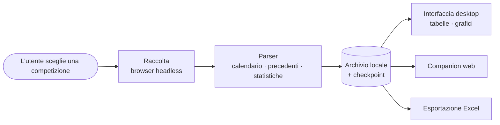

  

<a href="README.md">🇬🇧 English</a> · <b>🇮🇹 Italiano</b>

  
  

> [!NOTE]
> Questo repository è una **vetrina del progetto**: il codice sorgente è privato. Una demo è disponibile su richiesta.

## 🧭 Panoramica

Un'**applicazione desktop e web** che raccoglie i dati delle partite di calcio (calendari, precedenti e statistiche dettagliate) per le competizioni principali e li trasforma in tabelle, grafici e report Excel pronti per l'analisi.

Distribuita ai clienti come app Windows autonoma, con attivazione della licenza da remoto.

## ✨ Funzionalità principali

- ⚽ **Dashboard delle competizioni**: Mondiali, Serie A, Champions League, Premier League, Liga e altre
- 📅 **Calendario** → **precedenti** → **statistiche dettagliate**, in pochi clic
- 🤖 **Raccolta dati automatica tramite browser**, con avanzamento visibile e checkpoint per riprendere le scansioni lunghe dopo un'interruzione
- 📊 **Grafici integrati** per statistiche e tendenze
- 📁 **Esportazione in Excel** di ogni insieme di dati
- 🌐 **Due modalità**: interfaccia desktop nativa e companion web servito in locale
- 🔑 **Sistema di licenze** con attivazione remota
- 📦 **Pacchettizzata come eseguibile Windows** per utenti non tecnici

## 🏗️ Come funziona

## 🧰 Tecnologie

## 📬 Contatti

Realizzato da **Salvatore Cutaia**, ingegnere informatico specializzato in agenti AI e automazioni.

