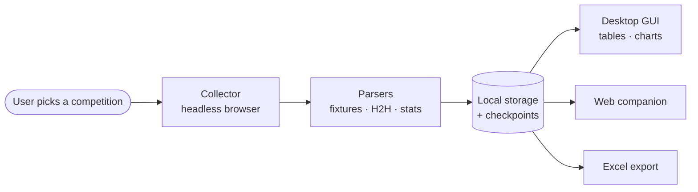

  

  
  

> [!NOTE]
> This repository is a **project showcase**: the source code is private. A demo is available on request.

## 🧭 Overview

A **desktop and web application** that collects football match data (fixtures, head-to-head records and detailed match statistics) for the main competitions, and turns it into tables, charts and Excel reports ready for analysis.

Distributed to clients as a standalone Windows app with remote license activation.

## ✨ Key features

- ⚽ **Competitions dashboard**: World Cup, Serie A, Champions League, Premier League, La Liga and more
- 📅 **Calendar view** → **head-to-head view** → **detailed stats**, in a few clicks
- 🤖 **Automated browser-based data collection** with progress tracking and checkpoints, so long scans can resume after an interruption
- 📊 **Built-in charts** for stats and trends
- 📁 **Excel export** of every dataset
- 🌐 **Two modes**: native desktop GUI and a web companion served locally
- 🔑 **Licensing system** with remote activation
- 📦 **Packaged as a Windows executable** for non-technical users

## 🏗️ How it works

## 🧰 Tech stack

## 📬 Contact

Built by **Salvatore Cutaia**, Computer Engineer specialized in AI agents & automations.

